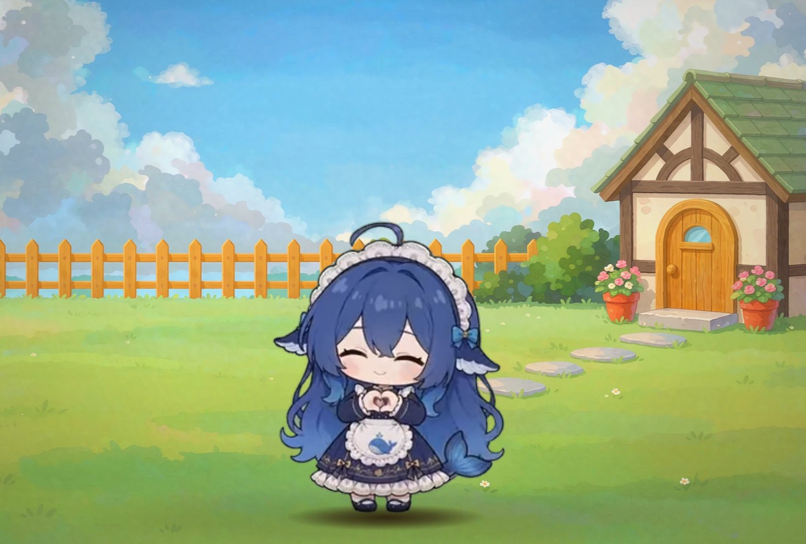

# 大肥鱼 · 她自己在家



> 把一只 2D 虚拟角色搬进浏览器：她自己待在一个房间里，待机、溜达、做上百种动作，
> 点一下有回应，头顶冒气泡说话，可以按住拖着走，还能换房间、切昼夜、下雨下雪。
>
> 纯网页，手机浏览器直接打开，不装 App。

**这不是 DeepSeek 官方项目。** 角色「大肥鱼」（鲸鱼娘）是社区二创形象，详见 [素材与许可](#素材与许可)。

仓库：<https://github.com/kanxingyv/dafeiyu-pet-web> · 许可：代码 MIT，**素材禁止商用**（见下方 [素材与许可](#素材与许可)）

---

## 它长什么样

打开页面就是一间房：角色自己待机、随机做动作（玩魔方、吃火锅、跳舞、打瞌睡……），
每隔半分钟自己溜达一趟。手机和电脑同时打开，两边看到的是同一只角色在做同一个动作。

| 操作 | 效果 |
|---|---|
| 点一下她 | Q 弹挤压 + 随机点击回应（傲娇 / 害羞 / 元气挥手……） |
| 按住拖动 | 跟手拖动，背景随拖动方向平移；拖到房间尽头她自己滑 |
| 点一下空白处 | 右上角浮出 `≡`，展开三个标签：动作（109 个，按分类）/ 表情（27 张）/ 房间（4 个场景） |
| 房间 → 光线 | 自动 / 白天 / 夜晚。自动按本机时间 6:30 天亮、18:30 天黑 |
| 房间 → 天气 | 晴 / 雨 / 雪（雨雪只落在窗外和院子里，屋里不会淋到） |
| 别的程序调她 | `POST /api/act?name=吃白饭`、`POST /api/say?image=可爱` |

---

## 获取代码

```bash
git clone https://github.com/kanxingyv/dafeiyu-pet-web.git
cd dafeiyu-pet-web
```

> 仓库不含 iOS 回落素材（`anim-mov/`，约 80MB）。需要的话跑 `scripts/fetch-mov.sh`，
> 它会把同名 `.mov` 拉到 `frontend/public/assets/anim-mov/`；不跑也不影响桌面浏览器。

## 快速开始

需要 Node 18+ 和 Python 3.10+。

```bash
# 1) 后端（:8765）
cd backend
pip install -r requirements.txt
python -m uvicorn main:app --port 8765

# 2) 前端（:5173，已配好 /api 与 /ws 代理到 8765）
cd ../frontend
npm install
npm run dev
```

打开 <http://127.0.0.1:5173>。

想一次性跑起来（含静态托管）：

```bash
cd frontend && npm run build
cd .. && docker compose up -d --build     # http://127.0.0.1:8765
```

> `docker-compose.yml` 里预留了 `DAFEIYU_WEB_TOKEN`。设了它，所有写接口都要带 `?k=<token>`；
> 留空就是不校验。**放到公网上一定要设**，否则任何人都能指挥她。

---

## 架构

```
浏览器
├── 世界层（.world）—— 一张比视口宽的房间图
│   ├── 背景图（白天 / 夜晚 / 雨 / 雪，多张叠着只改 opacity）
│   └── 角色（世界坐标 petX，脚底踩在 standY 线上）
├── 摄像机（camX）—— 横向窗口跟着角色走，卡在 [0, worldW-vw]
└── 控制层：动作选择器 / 气泡 / 署名

        ↕ WebSocket（多端同步）+ REST（外部调用）

FastAPI（单进程、无数据库、状态全在内存）
├── 静态托管 frontend/dist
├── 统一事件入口 /api/event
└── 连接表广播（手机和电脑看到同一只角色做同一个动作）
```

**为什么是「世界坐标 + 摄像机」而不是「固定背景 + 角色滑动」**：
后者角色会跑出画面被切掉一半。前者房间比屏幕宽，角色在房间里走、摄像机跟着 ——
她跑到墙边时摄像机停住，她才继续在屏幕上滑，永远不会跑丢。

几个关键取舍（细节见 [`docs/DESIGN.md`](docs/DESIGN.md)）：

- **动作是视频，不是 Live2D**：换来 109 段现成高质量动作，代价是做不了骨骼级联动。
- **双缓冲 `<video>` 交叉切换**：换动作时不黑屏。iOS 不认 VP9 的 alpha，所以另备 HEVC `.mov`。
- **左右跑是镜像**：素材只有朝左的走动，向右靠 CSS `scaleX(-1)`。
- **命中区收在角色本体**：视频画布 640×360 但角色只占中间 1/3，命中区按实测收边，不然空地也能抓住她。

---

## 接口

所有外部调用走**一个事件入口**，加新事件类型不用改老逻辑。

| 方法 | 路径 | 说明 |
|---|---|---|
| POST | `/api/event` | 统一事件（推荐） |
| POST | `/api/act?name=吃白饭&facing=right` | 点播动作 |
| POST | `/api/say?text=…&image=可爱` | 冒气泡（`text` 与 `image` 至少给一个） |
| GET | `/api/act?name=吃白饭` | 同上，方便浏览器地址栏直接试 |
| GET | `/api/actions` | 列出全部动作（按分类）与表情 |
| GET | `/api/health` | 健康检查 |
| GET | `/api/manifest` | 完整动作清单 |
| WS | `/ws` | 多端同步 |

```jsonc
{ "type": "act",   "name": "吃白饭", "facing": "left" }
{ "type": "say",   "text": "主人回来啦", "image": "可爱", "holdMs": 3000 }
{ "type": "say",   "image": "可爱" }          // 只发表情，不配字
{ "type": "state", "mode": "work", "workIndex": 2 }
{ "type": "poke" }
{ "type": "reload" }
```

Python 客户端（零依赖，失败不抛异常 —— 网页挂了不该把调用方的流程带崩）：

```python
from client import Fish

fish = Fish("http://127.0.0.1:8765")
fish.act("优雅女仆舞")
fish.say("主人回来啦～", image="可爱")
fish.state("work", work_index=2)
```

---

## 加自己的动作 / 房间

**动作是数据不是代码。**

1. 把透明 webm 丢进 `frontend/public/assets/anim/`（编号命名，如 `a110.webm`）
2. 在 `frontend/public/assets/filename-map.json` 的 `animations` 里登记「动作名 → a110.webm」
3. 在 `assets/config.mine.jsonc` 的某个分类 `actions` 里加上这个动作名
4. 重跑 `python scripts/gen_manifest.py`

**不想找新素材**：`scripts/make_action.py` 可以把几段现有动作首尾相接拼成新动作
（素材每段首尾都是标准正面站立，硬切不跳帧）：

```bash
python scripts/make_action.py 午后打盹 哈欠连天 原地小憩沉眠 打瞌睡被惊醒
```

**加房间**：丢一张 `xxx.webp` 进 `bg/` → 跑 `python scripts/analyze_room.py` 自动算出墙脚线与站立线 →
填进 `bg/scenes.json` → 前端「房间」标签里自动出现，不用改代码。

> 素材文件名一律用编号，不用中文。中文名在打包、跨平台解压、URL 编码上都踩过坑。
> 名字 ↔ 文件的对应关系只在 `filename-map.json` 里。

---

## 目录

```
.
├── frontend/                    Vite + React 18 + TypeScript
│   ├── src/
│   │   ├── engine/              播放器（双缓冲 / iOS 回落）、状态机、加权抽片
│   │   ├── scene/               世界尺寸 / 可走范围 / 摄像机、昼夜（纯函数）
│   │   ├── pet/PetStage.tsx     角色层：定位、朝向、拖拽跟手、Q 弹
│   │   ├── bubble/              头顶气泡（打字机 + 表情配图）
│   │   ├── ui/ActionPanel.tsx   动作 / 表情 / 房间 三标签抽屉
│   │   ├── weather/             雨、雪粒子层
│   │   └── net/                 REST + WebSocket 客户端
│   ├── public/assets/
│   │   ├── anim/                109 段透明 webm（≈56 MB，编号 a001…）
│   │   ├── memes/               27 张表情（编号 m001…）
│   │   ├── bg/                  4 个房间 × 昼 / 夜 / 雨 / 雪 + scenes.json
│   │   ├── filename-map.json    名字 → 编号文件名
│   │   └── manifest.json        动作清单（由脚本生成，别手改）
│   └── scripts/                 真浏览器验收脚本（Playwright）
├── backend/main.py              FastAPI：静态托管 + 事件总线 + WS
├── scripts/
│   ├── gen_manifest.py          扫 anim/ + 读配置 → 生成 manifest.json
│   ├── make_action.py           把几段动作拼成一段新动作
│   ├── analyze_room.py          从背景图算墙脚线 / 站立线
│   └── fetch-mov.sh             拉 iOS 用的 HEVC-alpha .mov（≈80 MB，不进 git）
├── assets/config.mine.jsonc     动作分类 / 权重 / 表情配置
├── client.py                    给脚本 / 机器人用的 Python 客户端
├── docs/DESIGN.md               设计说明与踩坑记录
├── Dockerfile
└── docker-compose.yml
```

`.mov` 素材（iOS 用）体积大，**不进仓库**，需要时：

```bash
bash scripts/fetch-mov.sh
```

没有 `.mov` 也能跑：Safari 会回落到 webm，动作正常，只是透明通道变成黑底。

---

## 验收

`tsc` 抓不到黑底、错位、裁切这类问题，所以改完要用真浏览器截图/断言：

```bash
cd frontend
npx tsc --noEmit
node scripts/shot.mjs            http://127.0.0.1:5173 ../work/web-check   # 桌面 + 手机截图
node scripts/verify-walk.mjs     http://127.0.0.1:5173                   # 跑动 + 摄像机
node scripts/verify-drag.mjs     http://127.0.0.1:5173                   # 拖拽跟手
node scripts/verify-hit.mjs      http://127.0.0.1:5173                   # 命中区贴角色本体
node scripts/verify-scenes.mjs   http://127.0.0.1:5173                   # 房间切换
node scripts/verify-memes.mjs    http://127.0.0.1:5173                   # 表情真的能加载
```

---

## 素材与许可

**这一节请务必看完再 fork。** 代码可以随便用，角色素材不行。

### 代码

`backend/`、`frontend/src/`、`scripts/`、`client.py` 等**程序代码**采用 **MIT**，见 [`LICENSE`](LICENSE)。

### 角色素材（重要）

`frontend/public/assets/anim/`、`memes/` 里的 **109 段动画 + 27 张表情**，
全部取自开源项目 **[dsh-pet](https://github.com/PC2005-cloud/dsh-pet)**（作者 **PC2005-cloud**），
本项目**没有**这些素材的版权，只按上游许可使用。

上游的许可分三层：

| 对象 | 许可 | 能商用吗 |
|---|---|---|
| dsh-pet 的**代码** | MIT | ✅ |
| dsh-pet 的**素材**（动画 / 提示词 / 源视频） | 自定义：**允许开源使用，禁止商用** | ❌ |
| 角色**形象**「大肥鱼」 | **[CC BY-NC-SA 4.0](https://creativecommons.org/licenses/by-nc-sa/4.0/deed.zh)** | ❌ 任何形式都不行 |

因此：

- **整个项目不可商用**（含周边、付费部署、带广告的站点）。想商用请自行替换角色与全部美术素材。
- **必须署名**：公开渠道要附上游地址 <https://github.com/PC2005-cloud/dsh-pet>。
  本项目的页面左下角已常驻这条署名，`LICENSE-ASSETS.md` 里也有完整声明。
- **相同方式共享**：基于该形象的衍生作品要以 CC BY-NC-SA 4.0 发布，不能改成更宽松的协议。
- 形象出处：原型「溟月」出自 B 站 [@上善无形](https://space.bilibili.com/4456176)，
  DeepSeek 版（女仆鲸鱼娘）设计出自 B 站 [@ZipZipPipe](https://space.bilibili.com/4168597)。
  **非 DeepSeek 官方形象**，请勿据此暗示与 DeepSeek 有关联。

完整声明见 [`LICENSE-ASSETS.md`](LICENSE-ASSETS.md) 与 [`NOTICE.md`](NOTICE.md)。

### 房间背景

`frontend/public/assets/bg/` 下 16 张房间图（4 个房间 × 昼 / 夜 / 雨 / 雪）由本项目用 AI 图像生成，
随本项目一起按 CC BY-NC-SA 4.0 提供。换掉它们不影响代码运行。

### 合成动作

`anim/` 里有 3 段（`午后打盹` / `摸鱼被抓` / `早起日常`）是本项目用 `scripts/make_action.py`
把上游片段首尾相接合成的，**沿用上游素材的许可**（允许开源使用、禁止商用）。

---

## 致谢

- **[dsh-pet](https://github.com/PC2005-cloud/dsh-pet)** —— 全部角色动画与表情的来源，
  以及「动作即数据」的配置思路。没有它这个项目不存在。
- **@上善无形**（原型「溟月」）、**@ZipZipPipe**（女仆鲸鱼娘设计）—— 角色形象原作者。
- 素材文件名用编号、`manifest` 由脚本生成、验收必须真浏览器截图 —— 这几条工程习惯都来自踩坑。

---

## 已知限制

- **无 HTTPS**：默认走 `http://IP:8765`。要接麦克风（浏览器强制安全上下文）必须上域名 + 证书。
- **iOS 透明依赖 `.mov`**：Safari 不认 VP9 webm 的 alpha 通道。
- **没有前后遮挡**：角色走到柜子/植物前会和家具叠在一起，要做得给背景加前景层。
- **左右跑是镜像**：围裙上的小鲸鱼会左右反过来。
- **动作是视频不是 Live2D**：做不了「眼睛跟随鼠标」这类骨骼级联动。
